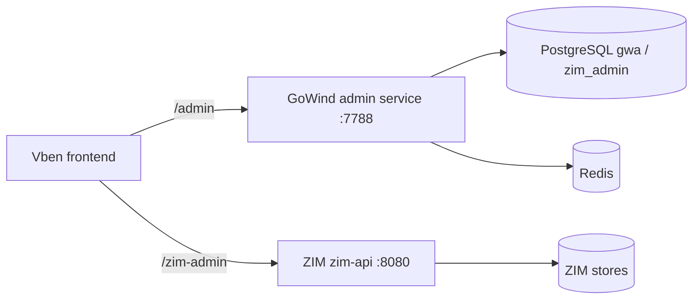

# zim-admin

<p align="center">
  <strong>Admin console for ZIM</strong><br/>
  <sub>Vue 3 + Vben Admin frontend · Go + Kratos + Ent backend · talks to ZIM over the <code>/admin</code> REST API</sub>
</p>

<p align="center">
  
  
  
  
</p>

<p align="center">
  <b>English</b> | <a href="./README.md">中文</a>
</p>

**zim-admin** is the management console for [ZIM](https://github.com/zciyuan/zim). It is a standalone repository with its own build and release cycle. It never connects to ZIM's PostgreSQL / MongoDB / Redis directly: all business data comes from `zim-api` via the `/admin` REST endpoints, while admin login, menus and button-level permissions are handled by [GoWind Admin](https://gitee.com/tx7do/go-wind-admin) RBAC.

| Component | Responsibility |
|---|---|
| Vben frontend (browser) | pages, tables, forms, menu rendering |
| GoWind admin service (`:7788`) | admin login, JWT, menus / roles / permission codes, SSE |
| ZIM `zim-api` (`:8080`) | `/admin` endpoints for users, groups, messages, audits, … plus per-route permission checks |

> **Status: alpha.** Twelve ZIM pages work today; write and high-risk operations are still being hardened. See [ZIM-INTEGRATION.md](./ZIM-INTEGRATION.md) for the contract.

## Architecture



In development Vite proxies both prefixes to keep everything same-origin; in production Nginx applies the same rules:

| Frontend prefix | Target | Notes |
|---|---|---|
| `/admin` | `http://localhost:7788` | GoWind: login, `/admin/v1/routes`, `/admin/v1/perm-codes`, SSE |
| `/zim-admin` | `http://localhost:8080` | ZIM: prefix rewritten to `/admin`, injects `X-ZIM-Admin-Source` / `X-ZIM-Admin-Permissions` |

Routes are backend-driven (`VITE_ROUTER_ACCESS_MODE=backend`): menus come from `/admin/v1/routes` and point at `src/views/app/zim/**`; the frontend holds no hard-coded route table.

## What it covers

Users (search, ban, kick, reset password) · groups (dismiss, transfer, mute) · family groups · message search (recall, delete) · in-app notifications · push certificates (APNs / FCM / vendors) · reports · sensitive words · key/value config · webhooks (event list, retries, DLQ replay) · operation audit log · platform ops status.

Twenty-two `zim:*` permission codes gate every `/admin` route; the full list is in [ZIM-INTEGRATION.md](./ZIM-INTEGRATION.md).

## Stack

- **Frontend**: Vue 3, TypeScript, Vben Admin 5.4, Ant Design Vue, Vite, Tailwind, pnpm 11.18.
- **Backend**: Go 1.26, Kratos v2, Ent (PostgreSQL; GORM wiring kept), Wire, protobuf.
- **Stores**: PostgreSQL (RBAC, menus, business metadata), Redis (cache / asynq queues), MinIO (objects).
- **ZIM integration**: `/admin` REST with service token + mTLS and permission headers.

Only the Vue 3 + Vben template is kept in this repository; the upstream React 19 and element-plus frontends were removed. Go code stays structurally identical to upstream GoWind Admin, with menus trimmed rather than modules deleted.

## Layout

```text
backend/
  app/admin/service/
    cmd/server/          # main.go + wiring_ent.go / wiring_gorm.go
    configs/             # auth / data / server / logger / oss / client
    internal/data/       # Ent schemas, repos, audit, caches
    internal/service/    # business services
  api/                   # protobuf definitions and generated Go / TS
  sql/                   # PostgreSQL / MySQL demo data
  docker-compose.yaml    # postgres / redis / minio / admin-service
frontend/admin/vue-vben/
  src/views/app/zim/     # the twelve ZIM pages
  vite.config.mts        # proxy rules
ZIM-INTEGRATION.md       # contract, permission points, integration notes
```

## Quick start

Prerequisites: Go 1.26, Node 20+ with pnpm 11.18, Docker 24+ (Compose v2).

```bash
# 1. dependencies + demo data
cd backend
docker compose up -d postgres redis minio
docker compose exec -T postgres psql -U postgres -d gwa < sql/postgresql-demo-data.sql

# 2. backend (REST :7788, SSE :7789)
cd backend/app/admin/service
make build_only
make run                        # go run ./cmd/server -c ./configs

# 3. frontend (http://localhost:15666)
cd frontend/admin/vue-vben
pnpm install
pnpm dev
```

Demo login is `admin / admin` (local only). When running the service on the host instead of in Compose, copy `configs/` to `configs-local/`, point hosts at `127.0.0.1`, and start with `-c ./configs-local`; `configs-local/` is not tracked.

To let ZIM accept this console, expose `/admin` on `zim-api`, trust the `zim-admin` source (service token + mTLS), and set `VITE_ZIM_ADMIN_TOKEN` for local development (the built-in default `dev-admin-token` must never leave a dev machine).

Optional: import the permission points with `go run ./run/import_permissions.go` from `backend/`. Files under `run/` are single-shot utilities and are not part of `go build ./...`.

## Contract with ZIM

- Prefix `/admin`; responses are `{ "code": 0, "data": ..., "message": "" }`.
- Writes carry `Idempotency-Key` (24 h); high-risk actions require confirmation, dual review and audit.
- Requests must claim `X-ZIM-Admin-Source: zim-admin`; permissions are checked per route from `X-ZIM-Admin-Permissions`.
- Admin metadata lives in its own `zim_admin` schema; `tenant_id` stays in GoWind and is pinned to `1` for ZIM.
- Never connect to ZIM stores directly, and never ship the service token inside a production bundle.

## Related repositories

| Repository | Description |
|---|---|
| [zim](https://github.com/zciyuan/zim) | Server: 11 services + `zimfw`, exposing `/v1`, `/api` and `/admin` |
| [zim-admin](https://github.com/zciyuan/zim-admin) | This repository — the admin console |
| [zim-web-client](https://github.com/zciyuan/zim-web-client) | Product frontend: React + TypeScript over `/v1` + WebSocket |

## Security

- Credentials in `configs/` (database, Redis, MinIO, JWT RSA key) are **upstream development samples**: replace and rotate them for any real deployment.
- Keep `/admin` behind a private network or VPN, with a dedicated service token plus mTLS. `VITE_ZIM_ADMIN_TOKEN` is a local-development convenience only.
- This repository ships no `node_modules`, build output, logs, local configs (`configs-local/`) or upstream `docs/`.

## Upstream and license

- Built on [GoWind Admin](https://gitee.com/tx7do/go-wind-admin) (MIT) with the [Vben Admin](https://github.com/vbenjs/vue-vben-admin) (MIT) frontend.
- ZIM-specific additions: the admin pages, the `/admin` integration layer and permission trimming.
- [MIT](./LICENSE), upstream copyright notices retained.
