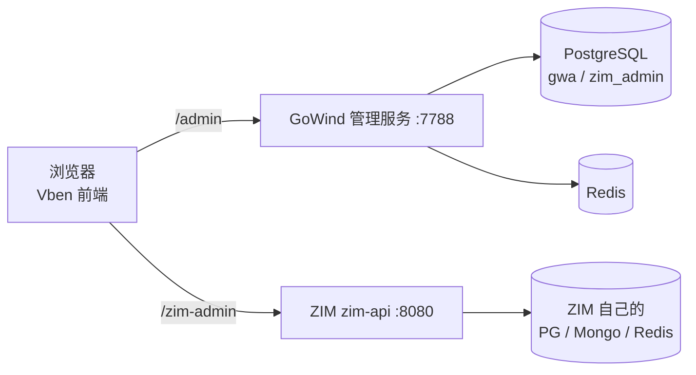

# zim-admin

<p align="center">
  <strong>ZIM 管理后台</strong><br/>
  <sub>Vue 3 + Vben Admin 前端 · Go + Kratos + Ent 服务端 · 通过 <code>/admin</code> REST 管理 ZIM</sub>
</p>

<p align="center">
  
  
  
  
  
</p>

<p align="center">
  <a href="./README.en-US.md">English</a> | <b>中文</b>
</p>

**zim-admin** 是 [ZIM](https://github.com/zciyuan/zim) 的管理后台，独立仓库、独立构建、独立发布。它不直接连 ZIM 的 PostgreSQL / MongoDB / Redis，所有业务数据都经 ZIM `zim-api` 的 `/admin` REST 获取；账号、菜单、按钮权限复用 [GoWind Admin](https://gitee.com/tx7do/go-wind-admin) 的 RBAC。

一句话概括分工：

| 角色 | 负责 |
|---|---|
| 浏览器里的 Vben | 页面、表格、表单、菜单渲染 |
| GoWind 管理服务（`:7788`） | 管理员登录、JWT、菜单/角色/权限码、SSE |
| ZIM `zim-api`（`:8080`） | 用户/群/消息/审计等业务数据的 `/admin` 接口与权限校验 |

> **Status: alpha.** 12 个 ZIM 管理页面已可用，高危及写操作仍在收敛；接口契约见 [ZIM-INTEGRATION.md](./ZIM-INTEGRATION.md)。

## 架构



开发态由 Vite 代理完成同源转发（生产环境换 Nginx，规则不变）：

| 前端前缀 | 目标 | 说明 |
|---|---|---|
| `/admin` | `http://localhost:7788` | GoWind：登录、`/admin/v1/routes`、`/admin/v1/perm-codes`、SSE |
| `/zim-admin` | `http://localhost:8080` | ZIM：代理把前缀改写为 `/admin`，并注入 `X-ZIM-Admin-Source` / `X-ZIM-Admin-Permissions` |
| `/api` | `http://localhost:5320/api` | 仅 mock，未使用 |

路由来自后端：`VITE_ROUTER_ACCESS_MODE=backend`，菜单由 `/admin/v1/routes` 下发，`component` 指向 `src/views/app/zim/**`，前端不写死路由表。

## 功能

| 页面 | 组件 | 能力 |
|---|---|---|
| 用户 | `views/app/zim/users` | 按 UID / 用户名 / 昵称 / 状态检索，封禁、踢下线、重置密码 |
| 群组 | `views/app/zim/groups` | GID / 名称 / 群主 / 类型，解散、转让、禁言 |
| 家庭组 | `views/app/zim/families` | 家庭组列表与解散 |
| 消息 | `views/app/zim/messages` | 按 seq / 发送者 / 接收者 / 类型检索，撤回、删除 |
| 通知 | `views/app/zim/notifications` | 站内通知列表与发布（仅 `zim:config:write` 可发） |
| 推送 | `views/app/zim/push` | APNs / FCM / 厂商证书配置与测试推送 |
| 举报 | `views/app/zim/reports` | 举报队列与处置状态 |
| 敏感词 | `views/app/zim/sensitive` | 词表增删 |
| 配置 | `views/app/zim/config` | 管理端键值配置读写 |
| Webhook | `views/app/zim/webhook` | 回调事件清单、失败重试与 DLQ 重放 |
| 审计 | `views/app/zim/audit` | 操作审计检索（操作人 / 动作 / 目标 / 时间） |
| 运维 | `views/app/zim/ops` | 平台接入状态与更新时间 |

权限点共 22 个（`zim:user:*`、`zim:group:*`、`zim:family:*`、`zim:msg:*`、`zim:sensitive:*`、`zim:push:*`、`zim:config:*`、`zim:audit:*`、`zim:oplog:list`），逐接口校验，完整清单见 [ZIM-INTEGRATION.md](./ZIM-INTEGRATION.md)。

## 技术栈

| 层 | 选型 |
|---|---|
| 前端 | Vue 3 + TypeScript + [Vben Admin](https://github.com/vbenjs/vue-vben-admin) 5.4 + Ant Design Vue + Vite + Tailwind，pnpm 11.18 |
| 后端 | Go 1.26 + [Kratos](https://github.com/go-kratos/kratos) v2 + [Ent](https://entgo.io/)（PostgreSQL，另留 GORM 接线）+ Wire + protobuf |
| 存储 | PostgreSQL（RBAC、菜单、业务元数据）、Redis（缓存 / asynq 队列）、MinIO（对象存储） |
| 对接 ZIM | `/admin` REST + 服务令牌 + mTLS，请求头带来源与权限 |

## 目录

```text
backend/
  app/admin/service/
    cmd/server/            # main.go + wiring_ent.go / wiring_gorm.go
    configs/               # auth / data / server / logger / oss / client
    internal/data/         # Ent schema、repo、审计与缓存
    internal/service/      # 业务 service
  api/                     # protobuf 定义与生成的 Go / TS 代码
  sql/                     # PostgreSQL / MySQL 演示数据
  docker-compose.yaml      # postgres / redis / minio / admin-service
frontend/admin/vue-vben/
  src/views/app/zim/       # 12 个 ZIM 管理页面
  src/router/              # 路由骨架（菜单由后端下发）
  vite.config.mts          # 代理规则
ZIM-INTEGRATION.md         # 与 ZIM 的契约、权限点、联调与权限导入记录
```

本仓只保留 Vue3 + Vben 一套前端（上游的 React19、element-plus 模板已移除），后端 Go 代码与上游 GoWind 保持同构，只做菜单级裁剪。

## 快速开始

前置：Go 1.26、Node 20+ 与 pnpm 11.18、Docker 24+（Compose v2）。

### 1. 起依赖与后端

```bash
cd backend
docker compose up -d postgres redis minio     # 5432 / 6379 / 9000
```

导入演示数据（租户 `super`、管理员 `admin/admin`，仅本地）：

```bash
docker compose exec -T postgres psql -U postgres -d gwa < sql/postgresql-demo-data.sql
```

编译并运行服务：

```bash
cd backend/app/admin/service
make build_only                               # go build -o ./bin/ ./...
make run                                      # go run ./cmd/server -c ./configs
```

- REST 监听 `:7788`，SSE 监听 `:7789`。
- 容器内跑时 `configs/` 的主机名（`postgres` / `redis` / `minio`）可直接用；**本机裸跑**请复制成 `configs-local/` 并把 host 改成 `127.0.0.1`（`configs-local/` 不入库），用 `-c ./configs-local` 启动。
- 本地联调可临时关验证码：`CaptchaEnabled=false`。

### 2. 起前端

```bash
cd frontend/admin/vue-vben
pnpm install
pnpm dev                                      # http://localhost:15666
```

`/admin` 打不开说明后端没起（502），`/zim-admin` 页面报错说明 ZIM 没起，都是预期现象。生产构建 `pnpm build`，产物静态托管，由 Nginx 按上表反代。

### 3. 让 ZIM 端认这个后台

```bash
# ZIM 侧需开放 /admin，并信任来源 zim-admin（服务令牌 + mTLS）
# 前端把令牌放进环境变量，默认值 dev-admin-token 只能本地用
VITE_ZIM_ADMIN_TOKEN=<服务令牌> pnpm dev
```

权限链路：登录后从 GoWind `/admin/v1/perm-codes` 取权限码 → 只保留 `zim:*` → 随请求头 `X-ZIM-Admin-Permissions` 下发 → ZIM `/admin` 逐接口校验，无权限返回 403。

### 4. 导入权限点与菜单（可选）

```bash
cd backend
go run ./run/import_permissions.go            # 导入 22 个 zim:* 权限点
```

`run/` 下是一次性的联调脚本（`import_permissions.go`、`create_menus.go`、`*probe.go`、`bcryptcheck.go`），各自是独立单文件程序，按需 `go run <file>`，不参与 `go build ./...`。

## 与 ZIM 的契约

- 前缀 `/admin`；响应统一 `{ "code": 0, "data": ..., "message": "" }`。
- 写操作带 `Idempotency-Key`（24h）；高危操作二次确认 + 双人复核 + 审计。
- 来源必须是 `zim-admin`（`X-ZIM-Admin-Source`），权限按 `X-ZIM-Admin-Permissions` 逐条校验，额度最小化。
- 管理端数据放独立 schema `zim_admin`；GoWind 保留 `tenant_id`，ZIM 固定 `1`。
- 禁止直连 ZIM 的 PostgreSQL / MongoDB / Redis，也禁止把服务令牌打进生产前端 bundle。

完整契约、权限表、T37 步骤与联调记录见 [ZIM-INTEGRATION.md](./ZIM-INTEGRATION.md)。

## 相关仓库

| 仓库 | 说明 |
|---|---|
| [zim](https://github.com/zciyuan/zim) | 服务端：11 个服务 + `zimfw` 框架层，提供 `/v1`、`/api`、`/admin` |
| [zim-admin](https://github.com/zciyuan/zim-admin) | 管理后台（本仓库），基于 GoWind Admin |
| [zim-web-client](https://github.com/zciyuan/zim-web-client) | 产品前端：React + TypeScript，走 `/v1` + WebSocket |

## 安全

- `configs/` 里的数据库/Redis/MinIO 口令、JWT RSA 私钥均为**上游开发示例**，生产环境必须全部替换并轮换。
- `/admin` 只应部署在内网或 VPN 后，使用独立服务令牌 + mTLS；服务令牌不得进入生产前端产物（`VITE_ZIM_ADMIN_TOKEN` 只用于本地）。
- 本仓库不含 `node_modules`、构建产物、运行日志、本地配置（`configs-local/`）与上游 `docs/`；发现泄露请走私密渠道而非公开 issue。

## 上游与许可

- 上游基线：[GoWind Admin](https://gitee.com/tx7do/go-wind-admin)（作者 tx7do，MIT）；前端脚手架 [Vben Admin](https://github.com/vbenjs/vue-vben-admin)（MIT）。
- 本项目在其之上补充 ZIM 管理页面、`/admin` 对接与权限裁剪，未 fork 上游关键框架代码。
- 许可证：[MIT](./LICENSE)，保留上游版权声明；第三方组件与各自许可证见上游仓库说明。
